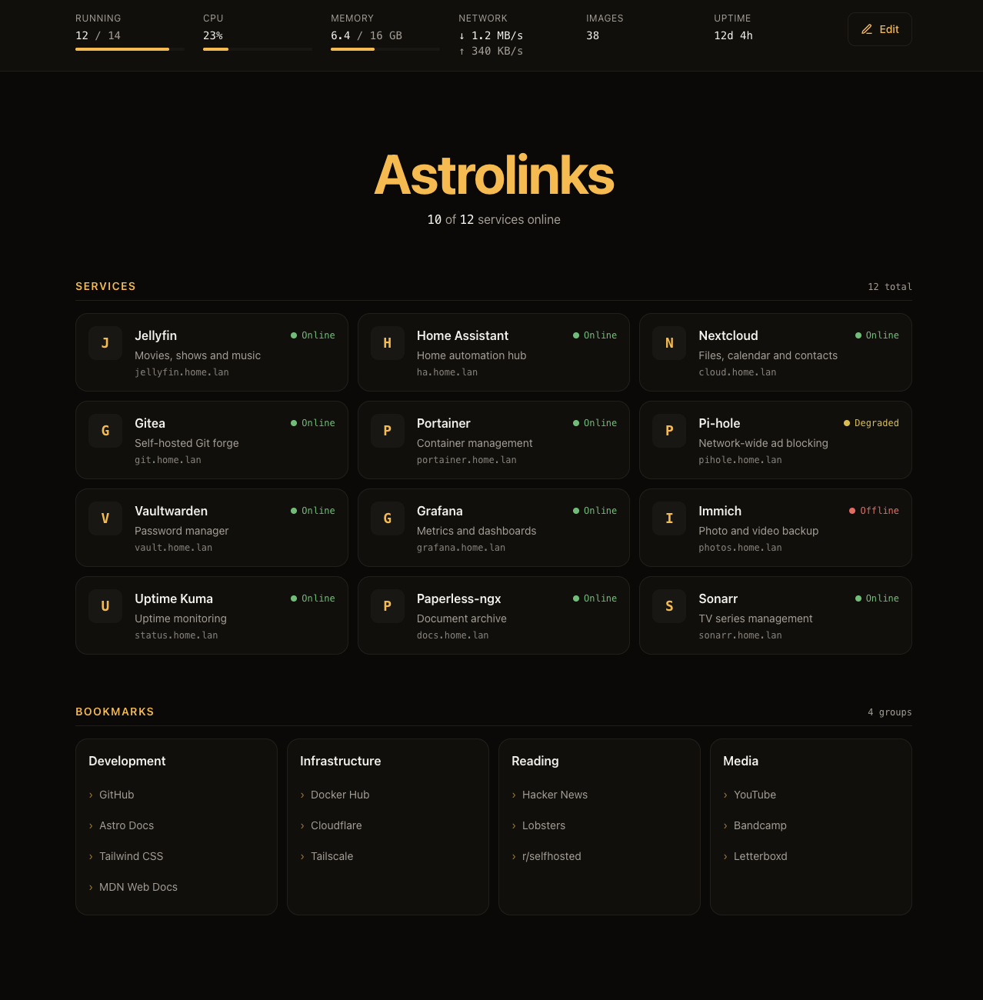

# Astrolinks

A self-hosted start page for your homelab: your services, your bookmarks and your Docker host at a glance, in one dark, keyboard-friendly dashboard.



## Features

- **Services:** a card per app with its address, a short description and a status badge (online, degraded or offline).
- **Bookmarks:** links sorted into groups.
- **Edit in the browser:** click **Edit** to add, change or remove services and bookmarks, or to move a bookmark to another group. Changes are saved on the server, so every device sees the same dashboard.
- **Plain YAML config:** everything lives in one readable file that you can also edit by hand. Comments and ordering survive saves from the dashboard.
- **Docker host stats:** running containers, CPU, memory, network, images and uptime along the top.
- **Works on any screen:** responsive from phones to desktops, usable with the keyboard alone, and it respects reduced-motion settings.

> **Early days:** the Docker stats are placeholder numbers for now, and service status is set by hand in the editor rather than checked automatically.

## Quick start

You need [Node.js](https://nodejs.org) 22.23 or newer, and [Bun](https://bun.sh) to install dependencies.

```sh
bun install
bun run build
HOST=0.0.0.0 bun run start
```

Then open <http://localhost:4321>, or `http://<server-ip>:4321` from another device. Without `HOST=0.0.0.0` the server only accepts connections from the machine it runs on.

On first start, Astrolinks creates `config/astrolinks.yaml` with some example services and bookmarks for you to replace.

## Configuration

### Environment variables

| Variable            | Default                  | Purpose                                                       |
| :------------------ | :----------------------- | :------------------------------------------------------------ |
| `ASTROLINKS_CONFIG` | `config/astrolinks.yaml` | Path to the config file, relative to the directory you start the server in. |
| `HOST`              | `localhost`              | Address to listen on. Use `0.0.0.0` to allow other devices.   |
| `PORT`              | `4321`                   | Port to listen on.                                            |

To keep the config somewhere else, such as a mounted Docker volume:

```sh
ASTROLINKS_CONFIG=/data/astrolinks.yaml bun run start
```

### The config file

```yaml
services:
  # Shown as a card in the Services grid
  - id: jellyfin                          # optional: derived from the name if left out
    name: Jellyfin
    url: http://jellyfin.home.lan
    description: Movies, shows and music  # optional
    status: online                        # online, degraded or offline (default: online)

bookmarkGroups:
  - id: development                       # optional
    title: Development
    links:
      - id: github                        # optional
        label: GitHub
        url: https://github.com
```

- URLs must be full addresses starting with `http://` or `https://`.
- After editing the file by hand, reload the page to see your changes.
- If the file has a mistake, the dashboard shows exactly what's wrong (for example `services[0].url: must be a full URL starting with http:// or https://`) instead of loading. It also refuses to save until the file is fixed, so your hand edits are never overwritten.
- `config/` is git-ignored because it holds your own data.

## Security

Astrolinks has no login: **anyone who can reach it can edit it.** Keep it on your home network, or put it behind a reverse proxy that requires authentication, such as Authelia, Authentik or your proxy's basic auth.

## Development

```sh
bun install
bun dev   # http://localhost:4321, reloads as you edit
```

| Command         | What it does                                                    |
| :-------------- | :-------------------------------------------------------------- |
| `bun dev`       | Start the development server with hot reload.                   |
| `bun run build` | Build the production server into `dist/`.                       |
| `bun run start` | Run the built server (`dist/server/entry.mjs`).                 |
| `bun preview`   | Preview the production build locally.                           |
| `bun astro ...` | Run Astro CLI commands, such as `bun astro check`.              |

### How it's built

[Astro](https://astro.build) renders each page on the server with the [`@astrojs/node`](https://docs.astro.build/en/guides/integrations-guide/node/) adapter, and [Tailwind CSS](https://tailwindcss.com) v4 handles styling.

```text
src/
├── components/     Page sections (Header, Hero, Services, Bookmarks, Editor) and ui/ building blocks
├── data/           Starter content for new config files, and the mock Docker stats
├── layouts/        The HTML page shell
├── lib/            Config schema and validation, YAML reading and writing, shared helpers
├── middleware.ts   Loads the config for each page request
├── pages/          index.astro, and api/config.ts for saving changes
├── scripts/        Browser code for edit mode
└── styles/         Design tokens (colors, fonts, radii) and global styles
```

Contributor conventions (design tokens, components, accessibility) are in [AGENTS.md](AGENTS.md).
